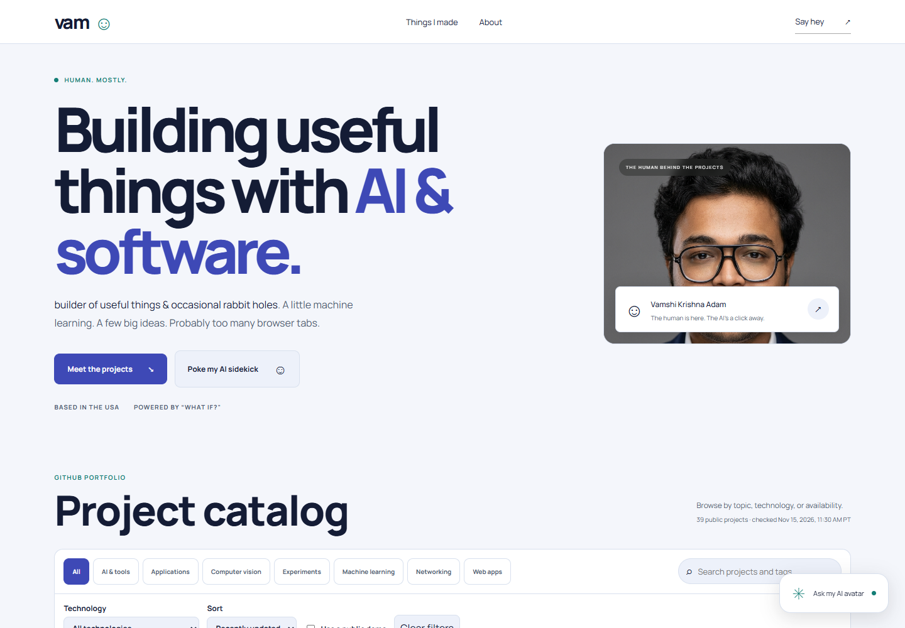

# PortfolioBot

Vamshi Krishna Adam’s project portfolio, with GitHub-powered project discovery and an assistant grounded in public project documentation.

[Live portfolio on Vercel](https://portfoliobot-nine.vercel.app/) · [Source on GitHub](https://github.com/vams2krish/PortfolioBot) · [Import into Vercel](https://vercel.com/new/clone?repository-url=https%3A%2F%2Fgithub.com%2Fvams2krish%2FPortfolioBot)

| Product view | Screenshot |
| --- | --- |
| Project gallery | [Browse projects](docs/assets/project-showcase.png) |
| Project detail | [Screenshots and deployment links](docs/assets/project-details.png) |
| Project assistant | [Scoped answer with sources](docs/assets/project-avatar-chat.png) |
| Contact | [Booking and contact links](docs/assets/contact.png) |
| Mobile | [Responsive homepage](docs/assets/portrait-mobile.png) |

## Run locally

Requires Node.js 20+. Run `npm start` and open http://127.0.0.1:4175/. Run `npm test` for automated tests and `npm run sync:github` to refresh the project snapshot manually.

Ollama is optional. When available, the local assistant answers using retrieved portfolio context; otherwise it shows relevant excerpts and source links. Configure `OLLAMA_URL` and optionally `OLLAMA_MODEL` in the process environment. The local-only image endpoint uses `AUTOMATIC1111_URL` and saves generated output separately from the supplied headshot.

## Deploy to Vercel

Import this repository using the link above. The project serves static assets from `public/` and API routes from `api/`. Hosted mode uses source excerpts and booking links without connecting to the local Ollama or image server. The hosted catalog reads the published snapshot from GitHub, so scheduled data refreshes also reach the live site.

## Product flows

- Search the catalog by project name, description, category, or tags. Combine category, technology, and public demo filters, then sort by recent activity, featured order, or name.
- Open a project to browse its available screenshots, description, technologies, and links.
- Open the source repository, a hosted demo, or a notebook when available. Owner-only previews and unavailable endpoints are labeled.
- Ask the assistant about a selected project. Follow-up questions stay scoped to that project until the scope is cleared.
- Book a call through Calendly or use the contact links.

## Design and data

The catalog layout and light palette live in `public/catalog.css`. The gallery uses three columns on desktop, two on tablets, and one on phones.

Personal details are in `profile.json`. The GitHub sync collects repository descriptions, languages, topics, READMEs, screenshots referenced in READMEs, and candidates from repository screenshot and documentation folders. It saves up to ten checked image references per project. GitHub Actions maintains the snapshot. Hosted requests cache the current GitHub snapshot for five minutes and use the bundled snapshot as a fallback if the refresh fails.

## API

| Method | Route | Purpose |
| --- | --- | --- |
| GET | `/api/profile` | Public profile and project gallery |
| GET | `/api/status` | Local service or hosted mode status |
| POST | `/api/chat` | Question with optional project context |
| POST | `/api/avatar` | Optional local image generation |

Browser checks cover the gallery, search, project details, deployment links, scoped chat, Calendly links, and mobile width. The screenshot gallery shows the application running in hosted fallback mode.
