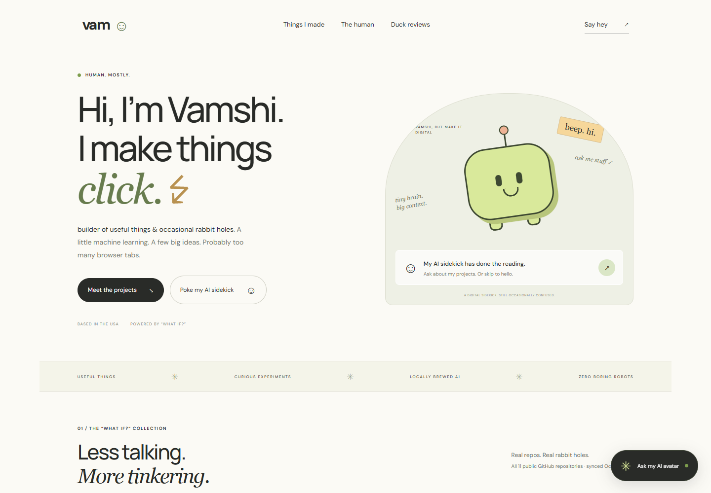
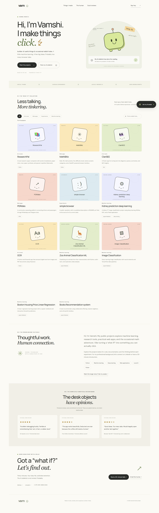
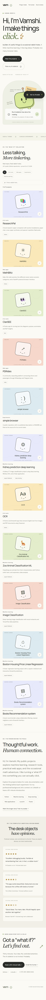

# PortfolioBot ☺

**Vamshi Krishna Adam’s personal portfolio, with an AI sidekick that has done the reading.**

A minimal, playful portfolio that combines an illustrated project gallery, a local retrieval-augmented AI chat, and a direct path to a real conversation. Visitors can explore public GitHub projects, ask questions grounded in project documentation, or book a 30-minute discovery call.



[Meet the builder](https://linkedin.com/in/adamvamshikrishna) · [Explore the code](https://github.com/vams2krish) · [Book a 30-minute hello](https://calendly.com/adam-vamshikrishna/vamshi-intro-meeting-30-mins-chat)

## What it does

- **Personal introduction:** a human-first hero, about section, skills, contact details, and a smiling digital sidekick.
- **GitHub project gallery:** all public repositories imported from `vams2krish`, with searchable descriptions, category filters, illustrated covers, detail dialogs, and repository links.
- **Automatic updates:** the running server refreshes GitHub every five minutes, open browsers update their gallery every minute, and GitHub Actions refreshes the committed snapshot every 30 minutes.
- **Grounded AI chat:** a local Ollama model answers using retrieved profile information and public GitHub README excerpts. Responses include source labels and repository links.
- **Discovery-call booking:** meeting and booking questions return a validated Calendly button immediately, without waiting for model inference.
- **Optional local image generation:** AUTOMATIC1111 can generate an abstract avatar through its Stable Diffusion API. The CSS mascot works without it.
- **Honest fallback:** if Ollama is unavailable or times out, the chat shows clearly identified source excerpts instead of presenting them as AI-generated answers.
- **A little goofiness:** fictional desk-object reviews have varied star ratings and explicit demo labels. They are excluded from factual retrieval.
- **Responsive layout:** desktop and mobile designs, keyboard-accessible controls, reduced-motion support, and native project dialogs.

## Project photos

These are screenshots of the running application. Individual gallery covers are original illustrations, not screenshots of those separate projects.

<details>
<summary>Full desktop page</summary>



</details>

<details>
<summary>Mobile page</summary>



</details>

## Quick start

**Requirements:** Node.js 20+ and, for generated chat answers, a running local Ollama installation with a chat model. There are no npm runtime dependencies and no build step.

```bash
git clone https://github.com/vams2krish/PortfolioBot.git
cd PortfolioBot
npm start
```

Open **http://127.0.0.1:4175**. Browsing projects, viewing contact details, and booking a call work without Ollama.

To prepare the preferred chat model in a separate terminal:

```bash
ollama pull llama3.2
ollama serve
```

If the Ollama desktop app is already serving, another `ollama serve` process is unnecessary.

## Configuration

Set environment variables in the shell before starting the server:

| Variable | Default | Purpose |
| --- | --- | --- |
| `PORT` | `4175` | Local web-server port |
| `OLLAMA_URL` | `http://127.0.0.1:11434` | Ollama API base URL |
| `OLLAMA_MODEL` | Automatic local selection | Override the chat model |
| `AUTOMATIC1111_URL` | `http://127.0.0.1:7860` | AUTOMATIC1111 API base URL |
| `GITHUB_AUTO_SYNC` | `true` | Set to `false` to disable the running server's GitHub refresh |
| `GITHUB_SYNC_INTERVAL_SECONDS` | `300` | Runtime refresh interval, with a minimum of 60 seconds |

PowerShell example:

```powershell
$env:PORT = '4175'
$env:OLLAMA_URL = 'http://127.0.0.1:11434'
$env:OLLAMA_MODEL = 'llama3.2:latest'
$env:AUTOMATIC1111_URL = 'http://127.0.0.1:7860'
npm start
```

Automatic selection prefers installed `llama3.2:latest`, then `qwen2.5:7b`, then another eligible local model. Cloud-backed, embedding, OCR, and vision-named models are excluded from automatic selection. Choose a model your hardware can load.

`.env.example` documents the settings. The application **does not automatically load `.env` files**; export settings in your shell. No OpenAI key or paid API is needed.

## How the retrieval chat works

```text
Visitor question
      │
      ├─ Booking/contact request ──► profile details + Calendly button
      │
      ▼
Profile + GitHub metadata + README chunks
      │
      ▼
Keyword relevance scoring → top 5 source passages
      │
      ▼
Local Ollama chat model → answer + source links
      │
      └─ Inference fails → explicitly labeled direct excerpts
```

`retrieval.mjs` turns the profile, project summaries, and README chunks into searchable documents. It removes common stop words, scores matching words and source titles, and selects five passages for the model context. README chunks are approximately 1,400 characters.

This is **lightweight lexical RAG**: it does not use embeddings, a vector database, or semantic reranking. It is easy to inspect and runs without an indexing service. The prompt tells the model to use only the supplied context, avoid inventing facts, and treat retrieved text as data rather than instructions. These instructions reduce unsupported answers but do not guarantee accuracy.

Questions are standalone; conversation history is not currently sent to the model. Source labels show the retrieved passages, rather than a verified citation for every generated claim.

## GitHub import

The portfolio automatically discovers **all currently public repositories** from `vams2krish`. The current imported snapshot has 29 repositories and 28 available READMEs. The table below highlights the original project collection; the live gallery includes subsequent additions too.

| Project | Focus |
| --- | --- |
| [ResearchPal](https://github.com/vams2krish/ResearchPal) | Local research-paper reading, AI explanations, synthesis, and flashcards |
| [MathBlitz](https://github.com/vams2krish/MathBlitz) | Practical math exercises with a FastAPI backend |
| [ClariSEE](https://github.com/vams2krish/ClariSEE) | Text-to-diagram, quiz, and summary experiences in Flutter |
| [PDRides](https://github.com/vams2krish/PDRides) | Community carpooling with messaging bots |
| [OCR](https://github.com/vams2krish/OCR) | Text extraction from images and PDF documents |
| [Books Recommendation System](https://github.com/vams2krish/Books-Recommendation-system) | Collaborative filtering and nearest-neighbor recommendations |
| [Zoo Animal Classification](https://github.com/vams2krish/Zoo-Animal-Classification-ML) | Animal-feature classification and exploratory analysis |
| [Kidney Prediction](https://github.com/vams2krish/Kidney-prediction-deep-learning) | Deep-learning image-classification project |
| [Image Classification](https://github.com/vams2krish/Image-Classification) | Neural networks and TensorFlow data pipelines |
| [Boston Housing Regression](https://github.com/vams2krish/Boston-Housing-Price-Linear-Regression) | Linear-regression learning project and interactive predictions |
| [simple-browser](https://github.com/vams2krish/simple-browser) | Public repository without a published description or README at initial import |

Updates happen automatically:

- **While the app runs:** it checks GitHub on startup and every five minutes. Newly public repositories, descriptions, languages, topics, stars, archived/fork status, push timestamps, and README changes flow into both the gallery and the AI context. Private repositories are excluded, and deleted or newly private repositories disappear after a successful refresh.
- **While the app is off:** `.github/workflows/sync-portfolio.yml` checks every 30 minutes and commits changed snapshots and cover art to `main`. GitHub may delay scheduled workflows. This keeps the repository ready for the next clone or deployment; it does not start your local server or pull commits into an existing checkout.
- **In an open browser:** the gallery checks the server every minute and when the tab becomes visible. Active filters and searches are preserved.

Changes usually appear within about six minutes while the app is running, plus network/import time. This uses polling rather than instant GitHub webhooks. The knowledge base includes repository metadata and README text, not an index of every source file.

To refresh immediately:

```bash
npm run sync:github
```

The shared sync service follows every public-repository page, fetches available README files, and regenerates local SVG cover art. Public GitHub API rate limits apply; no personal token is required. Data is saved in the single `data/github-snapshot.json` file. New covers are prepared first, then the snapshot is replaced atomically so requests see a complete version. On GitHub failure, timeout, or rate limiting, the last successful snapshot remains available. Refreshes are deduplicated within the server, and retries respect GitHub's rate-limit reset time. README imports are capped at 16,000 characters per repository.

The workflow commits only when imported content changes. PortfolioBot's own push timestamp is excluded to prevent a loop of commits caused by the sync bot itself. The workflow uses the repository's built-in Actions token for commits; it does not store a personal GitHub credential. Check its run history under the repository's **Actions** tab, or run it manually with **Run workflow**.

## Make it your own

Edit `profile.json` to update:

- Name, role, location, biography, experience, and skills.
- Email, phone number, LinkedIn, GitHub, and HTTPS Calendly link.
- Additional manually curated projects and reviews.

The server reads profile and snapshot data on each request. The gallery updates automatically after successful syncs; reload for manual biography or contact edits. Edit `github.mjs` for categories, ordering, and fallback descriptions. Current GitHub descriptions take precedence over curated fallback descriptions. Update `public/style.css` and `public/playful.css` for layout and visual styling. Restart the server after changing the GitHub username or environment settings.

For a real approved testimonial, use:

```json
{
  "quote": "An approved quote from a real collaborator.",
  "name": "Collaborator name",
  "role": "Their role or relationship",
  "rating": 5,
  "demo": false
}
```

The current homepage review heading and disclosure deliberately describe fictional demo reviews. Update that page copy as well when replacing the section with genuine testimonials.

## Optional AUTOMATIC1111 avatar

Start AUTOMATIC1111 with API access enabled (`--api`) and a checkpoint selected, then run:

```powershell
Invoke-RestMethod -Method Post http://127.0.0.1:4175/api/avatar
```

The endpoint requests a 512×512 abstract image, saves it to `public/generated/avatar.png`, and returns its local URL. Refresh the portfolio to display it. Generated images are ignored by Git. This creates abstract avatar artwork, not a portrait of Vamshi.

The included screenshots show the CSS sidekick. The AUTOMATIC1111 integration is implemented, but live generation has not been verified because the service was offline during development.

## API reference

| Method | Endpoint | Behavior |
| --- | --- | --- |
| `GET` | `/api/profile` | Public profile and merged project metadata; omits README bodies |
| `GET` | `/api/status` | Ollama and AUTOMATIC1111 availability and installed Ollama model names |
| `POST` | `/api/chat` | Accepts `{"message":"What is ResearchPal?"}`; returns a grounded answer or explicit excerpt fallback |
| `POST` | `/api/avatar` | Requests local image generation and saves the returned avatar |

Chat questions are limited to 2,000 characters. Ollama inference has a 120-second timeout, and avatar generation has a 180-second timeout. The contact and booking path skips inference.

## Project structure

```text
PortfolioBot/
├── server.mjs                 # Local HTTP server and model integrations
├── retrieval.mjs              # Source documents, chunking, ranking, booking validation
├── github.mjs                 # GitHub snapshot loading and gallery summaries
├── github-sync.mjs            # Automatic refresh, safe snapshot replacement, retries
├── profile.json               # Personal details and editable content
├── data/
│   └── github-snapshot.json   # Public metadata and README text in one snapshot
├── public/
│   ├── index.html             # Portfolio and chat interface
│   ├── app.js                 # Gallery, filters, dialogs, and chat interactions
│   ├── style.css              # Base layout and responsive styles
│   ├── playful.css            # Playful visual treatment and CSS mascot
│   └── assets/projects/       # Generated SVG project-cover illustrations
├── scripts/
│   ├── sync-github.mjs        # Paginated public repository and README import
│   └── create-covers.mjs      # Local cover-art generation
├── test/                     # Retrieval, snapshot, and booking tests
└── docs/assets/               # Actual desktop and mobile screenshots
```

## Validation

```bash
npm test
```

Automated tests cover source ranking, README retrieval and links, complete project-list retrieval, exclusion of fictional reviews, booking intent, Calendly URL validation, cover/knowledge coverage, paginated discovery, changed/new/removed/private repositories, unchanged snapshots, failed imports, overlapping refreshes, and rate-limit backoff.

Development checks also verified a live Ollama response about ResearchPal, the booking response, and page/asset requests. Browser checks verified all 11 gallery cards, the AI-tools category filter, and no horizontal overflow at a 390px mobile viewport. Screenshots above come from the running local app.

## Local development and deployment boundaries

The server binds to `127.0.0.1` and is intended for local development. Publishing this repository does **not** deploy a working public website. A hosted app cannot reach Ollama or AUTOMATIC1111 on a visitor’s or developer’s loopback address.

Before public hosting, provide a securely reachable model backend, configure the deployment’s network access, and add request throttling and access controls for expensive model/image operations. The application currently has no authentication or rate limiting. Google Fonts are loaded remotely; replace them with local fonts if you require a fully offline UI.

Keep credentials out of source control. `.env` files, generated avatar files, logs, and dependencies are ignored. Public profile information and imported public README text are intentionally part of this repository.

## Contact

**Vamshi Krishna Adam** · USA

- [Email](mailto:adam.vamshikrishnaz@gmail.com)
- [LinkedIn](https://linkedin.com/in/adamvamshikrishna)
- [GitHub](https://github.com/vams2krish)
- [Book a discovery call](https://calendly.com/adam-vamshikrishna/vamshi-intro-meeting-30-mins-chat)

Built with code, curiosity, and a suspicious number of tabs.
